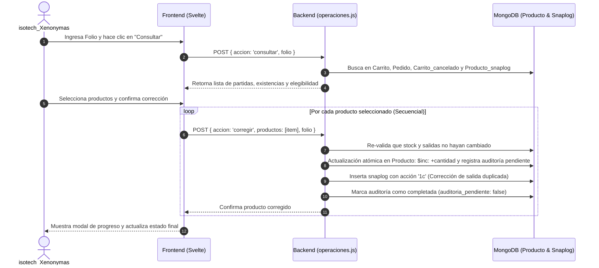

# Análisis de la Herramienta: Salidas Duplicadas (`/app/dev_tools/salidas_duplicadas`)

## 1. Origen y Propósito de la Herramienta

La herramienta fue creada a partir del commit [`562a57c`](file:///c:/laragon/www/xenon) con el objetivo de **resolver un problema crítico de inconsistencia en el inventario**:

### El Problema de Raíz:
Cuando un pedido se cambia a estatus **"Envío"** (en `pedido_pipeline_service.js`), el sistema realiza un descuento físico de existencias (`$inc: { 'existencia.actual': -cantidad }`) y genera un registro de auditoría (`Producto_snaplog` con acción `2`).
* Debido a **solicitudes concurrentes** (por ejemplo, múltiples clics en "Envío", dos pestañas abiertas o reintentos rápidos de red), un mismo pedido podía descontar dos veces las existencias de sus productos, generando **dos snaplogs de salida (acción `2`)** para el mismo folio y la misma cantidad.
* **Consecuencia:** El inventario físico quedaba con un descuento indebido duplicado (se restaban por ejemplo 6 unidades cuando el pedido era solo de 3).

---

## 2. Acceso y Seguridad

La herramienta tiene una **doble capa de seguridad muy estricta**:

1. **En la Interfaz (Frontend):**
   * Solo se muestra en el menú lateral ([`side_panel.svelte`](file:///c:/laragon/www/xenon/src/routes/_layouts/side_panel.svelte)) y en la vista ([`index.svelte`](file:///c:/laragon/www/xenon/src/routes/app/dev_tools/salidas_duplicadas/index.svelte)) si:
     * El usuario tiene el rol `administrador`.
     * El nombre de usuario es exactamente: **`isotech_Xenonymas`**.
2. **En el Servidor (Backend):**
   * En [`operaciones.js`](file:///c:/laragon/www/xenon/src/routes/app/dev_tools/salidas_duplicadas/operaciones.js) (líneas 107-110), el endpoint `POST` valida estrictamente:
     ```javascript
     if (!accesos.esta_logueado(req)) return res.status(401).send({ ok: false, mensaje: 'Sesión expirada.' });
     if (!accesos.tiene_permisos_administrativos(req) || req.user.usuario !== 'isotech_Xenonymas') {
         return res.status(403).send({ ok: false, mensaje: 'Acceso restringido.' });
     }
     ```
   * Si cualquier otro usuario intenta consumir el endpoint, recibe un error `403 Forbidden`.

---

## 3. Criterios de Elegibilidad para Corregir (`_criterios.js`)

La herramienta **NO permite corregir a ciegas**. Para que un producto de un pedido sea marcado como **Elegible para Corregir**, debe cumplir rigurosamente todas estas condiciones:

| Criterio | Validación | Motivo |
| :--- | :--- | :--- |
| **Corrección previa** | No debe tener una corrección registrada en `producto.correcciones_salida_duplicada` para ese folio. | Evita sumar existencias dos veces. |
| **Cantidad válida** | La cantidad del producto en el pedido debe ser un entero positivo (`> 0`). | Integridad de datos. |
| **Exactamente 2 salidas** | Deben existir **exactamente dos registros** en `Producto_snaplog` con acción `2` para ese folio y producto. | Si hay 1 salida es normal; si hay 3 o más, es ambiguo y requiere revisión manual. |
| **Consistencia de stock** | Ambos snaplogs deben tener la misma cantidad del pedido y su variación (`inventario_antes - inventario_despues`) debe ser igual a la cantidad del pedido. | Comprueba que ambos registros efectivamente descontaron inventario. |
| **Estatus del pedido** | El pedido **no debe estar cancelado** (`Carrito_cancelado`). | Si el pedido ya se canceló, las existencias se devolvieron por el flujo de cancelación. |
| **Partida única** | El producto no debe estar duplicado como dos renglones distintos dentro del mismo pedido. | Evita ambigüedad en el descuento de líneas separadas. |

> [!WARNING]
> Si el producto no cumple cualquiera de estas reglas, se muestra con estado **"No corregible"** y con un motivo explícito (ej: *"Se encontraron 1 salidas; se requieren exactamente dos"* o *"El pedido está cancelado"*).

---

## 4. Proceso de Corrección (Paso a Paso)

Cuando el operador selecciona uno o varios productos y hace clic en **"Corregir"**:



### Características de Seguridad del Proceso:
1. **Re-validación en tiempo real:** Antes de tocar la BD, el backend vuelve a consultar el producto. Si otro usuario movió el inventario mientras el operador miraba la pantalla, la operación se cancela para evitar inconsistencias.
2. **Escritura Atómica con Journaling:**
   * Utiliza `{ writeConcern: { w: 1, j: true } }` para garantizar que la escritura esté escrita en disco en MongoDB standalone.
   * En una sola operación atómica incrementa `existencia.actual` y guarda la evidencia en el array `producto.correcciones_salida_duplicada`.
3. **Mecanismo de Recuperación de Snaplog (`auditoria_pendiente`):**
   * Si por caída de red o reinicio del servidor el stock se incrementó pero el snaplog no se guardó, la herramienta detecta la bandera `auditoria_pendiente: true` y muestra un botón: **"Recuperar snaplog"**.
   * Este botón crea el snaplog faltante **sin volver a modificar existencias**, resolviendo la auditoría pendiente limpiamente.
4. **Acción `1c` en Snaplogs:**
   * Las correcciones no se registran como inyecciones comunes (`1`), sino con la acción específica **`1c`** (*Corrección de salida duplicada*), vinculando los `_id` de las dos salidas erróneas para que en el historial (`todos_los_movimientos`) se vea claramente por qué y quién hizo la corrección.

---

## 5. Módulos que Componen la Herramienta

| Archivo | Función Principal |
| :--- | :--- |
| [`index.svelte`](file:///c:/laragon/www/xenon/src/routes/app/dev_tools/salidas_duplicadas/index.svelte) | Vista principal: formulario de búsqueda por folio, listado de productos, selección múltiple y botones de acción. |
| [`operaciones.js`](file:///c:/laragon/www/xenon/src/routes/app/dev_tools/salidas_duplicadas/operaciones.js) | Endpoint backend (`/app/dev_tools/salidas_duplicadas/operaciones`): implementa `consultar`, `movimientos`, `corregir` y `recuperar_auditoria`. |
| [`_criterios.js`](file:///c:/laragon/www/xenon/src/routes/app/dev_tools/salidas_duplicadas/_criterios.js) | Lógica pura de validación de elegibilidad y redacción de motivos. |
| [`_ModalMovimientos.svelte`](file:///c:/laragon/www/xenon/src/routes/app/dev_tools/salidas_duplicadas/_ModalMovimientos.svelte) | Modal que permite ver todo el historial de snaplogs de un producto paginado, resaltando en amarillo los del folio en consulta. |
| [`_ModalProgreso.svelte`](file:///c:/laragon/www/xenon/src/routes/app/dev_tools/salidas_duplicadas/_ModalProgreso.svelte) | Diálogo modal que bloquea la pantalla durante correcciones por lote, mostrando el producto actual y barra de progreso. |
| [`_progreso.js`](file:///c:/laragon/www/xenon/src/routes/app/dev_tools/salidas_duplicadas/_progreso.js) | Orquestador secuencial que procesa producto por producto para evitar condiciones de carrera. |
| [`Docs/correccion_salidas_duplicadas.md`](file:///c:/laragon/www/xenon/Docs/correccion_salidas_duplicadas.md) | Documentación técnica detallada del incidente y operación. |

---

## 6. Automatización y Detección Global (Nueva Pestaña de 6 Meses)

Para eliminar la necesidad de identificar folios manualmente uno a uno, se incorporó un sistema de auditoría y escaneo proactivo en [`operaciones.js`](file:///c:/laragon/www/xenon/src/routes/app/dev_tools/salidas_duplicadas/operaciones.js) e [`index.svelte`](file:///c:/laragon/www/xenon/src/routes/app/dev_tools/salidas_duplicadas/index.svelte):

### 1. Backend (`escanearSalidasDuplicadas`):
* Ejecuta un pipeline de agregación sobre `Producto_snaplog` filtrando por:
  - Salidas de inventario (`accion: '2'`).
  - Rango de fechas: últimos 6 meses (configurable a 3 o 12 meses).
  - Folio asignado (`pedido.folio`).
* Agrupa por `{ folio, producto_id }` y filtra aquellos con `total_salidas >= 2`.
* Cruza con las colecciones `Carrito`, `Pedido`, `Carrito_cancelado` y `Producto` para:
  - Determinar si el pedido fue cancelado.
  - Verificar si el producto ya fue corregido previamente (`producto.correcciones_salida_duplicada`).
  - Detectar si tiene auditoría de snaplog pendiente.
  - Clasificar cada caso en: **Elegible para revisión**, **Ya corregido**, **Auditoría pendiente** o **Anomalía grave**.

### 2. Frontend (Agrupación por Pedidos y Modales):
* **Tabla Principal por Pedidos:**
  - En lugar de saturar la vista listando cientos de productos sueltos, la tabla agrupa por **Pedido / Folio**.
  - Cada fila muestra: Folio, Cliente, Total de productos afectados (con desglose de elegibles, corregidos y snaplogs pendientes) y Estado del pedido.
  - Filtro interactivo para ver solo pedidos pendientes de corrección o completados.
* **Modal de Gestión del Pedido (`_ModalProductosPedido.svelte`):**
  - Al hacer clic en **"Ver productos y corregir"**, se abre un modal con el desglose completo de productos de ese folio.
  - Incluye selector para ver solo los productos con duplicidad o todos los del pedido.
  - Permite seleccionar productos por lote y corregirlos con confirmación y barra de progreso (`_ModalProgreso.svelte`).
* **Modal de Movimientos Superpuesto (`_ModalMovimientos.svelte`):**
  - Cada producto dentro del modal del pedido cuenta con su botón **"Ver movimientos"**, que abre el modal de historial de snaplogs sobrepuesto para auditar antes de aplicar correcciones.

---

## 7. Reporte PDF de Corroboración Física en Almacén (`pdf.js`)

Para cerrar el ciclo de control de inventario de forma segura y permitir corroborar físicamente en anaquel las piezas reincorporadas, se implementó el generador de reportes PDF:

* **Endpoint Autorizado:** [`/app/dev_tools/salidas_duplicadas/pdf?folio=XXXXX`](file:///c:/laragon/www/xenon/src/routes/app/dev_tools/salidas_duplicadas/pdf.js).
* **Activación de la Acción:**
  1. En la tabla de pedidos escaneados: botón **"📄 PDF Corroboración"** activo en pedidos corregidos.
  2. En el modal del pedido (`_ModalProductosPedido.svelte`): botón **"📄 Descargar PDF de Corroboración Física"** al completarse la corrección.
  3. En la consulta manual (`index.svelte`): botón en la cabecera del pedido si tiene partidas corregidas.
* **Estructura del Documento:**
  - **Encabezado Institucional:** Datos del pedido, cliente, auditor responsable (`isotech_Xenonymas`), total de piezas y fecha de emisión.
  - **Tabla de Conteo:** Muestra consecutivo, código, descripción del producto, cantidad reincorporada (`+X`), y la **Existencia en Sistema (Físico esperado)**.
  - **Columnas de Verificación Física:** Espacio en blanco para anotar el conteo real en almacén (`Físico Real`) y casilla de verificación (`Visto Bueno`).
  - **Bloque de Firmas:** 3 firmas requeridas (Auditado en Sistema, Conteo Físico en Almacén por Almacenista y Validación por Supervisor).
